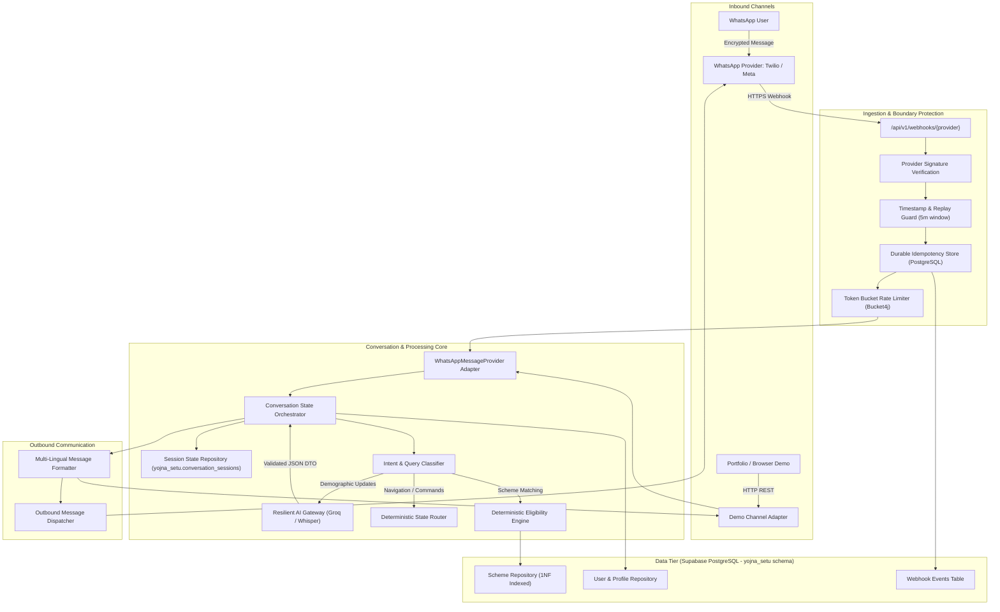

# YOJNA SETU V2 — SYSTEM ARCHITECTURE
**Document:** `docs/v2/ARCHITECTURE.md`  
**Version:** 2.0.0  
**Status:** APPROVED (PHASE 1 SPECIFICATION)  
**Classification:** HIGH-LEVEL & DETAILED TECHNICAL ARCHITECTURE  

---

## 1. Architectural Vision & Core Principles

Yojna Setu V2 is designed as a **WhatsApp-first, provider-agnostic, deterministic government-scheme discovery and eligibility assistant**. It replaces the legacy prototype's monolithic, in-memory, insecure implementation with a hardened, production-grade micro-modular architecture.

### 1.1 Fundamental Design Tenets
1. **Deterministic Authority:** The eligibility matching engine and verified database records are the sole authority on scheme qualifications. AI models are strictly unprivileged processing layers.
2. **Zero-Trust Webhook Ingestion:** All inbound webhook traffic is treated as untrusted until cryptographically verified (HMAC-SHA1), replay-checked, deduplicated, and rate-limited.
3. **Provider Portability:** Business logic has zero coupling to Twilio. Transport interfaces allow transparent swapping between Twilio, Meta Cloud API, and a Browser-based interactive demo.
4. **Data Isolation & Normalization:** Complete First Normal Form (1NF) relational design hosted exclusively in the `yojna_setu` schema of Supabase PostgreSQL (Project #2), completely isolated from sibling applications (`whatsapp_agent`, `myca`).
5. **Session Durability & Profile Immutability:** State machines persist in PostgreSQL; returning user messages cannot silently overwrite verified profile attributes without explicit user confirmation.
6. **Privacy by Design (DPDPA 2023):** Zero plaintext PII in logs; phone numbers indexed via one-way cryptographic hashes; full support for data minimization and deletion.

---

## 2. End-to-End System Architecture

---

## 3. Subsystem Breakdown

### 3.1 Provider-Agnostic Webhook & Ingestion Layer
The application decouples message arrival from message processing:
- **`WhatsAppMessageProvider` (Interface):** Defines standardized contracts for receiving normalized inbound messages (`InboundMessage`) and dispatching outbound messages (`OutboundMessage`).
- **`TwilioWhatsAppProvider` (Implementation):**
  - Extracts Twilio payload parameters (`From`, `Body`, `MessageSid`, `MediaUrl0`).
  - Verifies `X-Twilio-Signature` using official `Twilio.RequestValidator`.
  - Normalizes E.164 phone numbers (e.g. `whatsapp:+919876543210` -> `+919876543210`).
- **`MetaWhatsAppProvider` (Extensible Target):** Ready adapter for Meta Cloud API webhook JSON format and SHA-256 app secret signature verification.
- **`BrowserDemoProvider` (Demo Adapter):** Bypasses SMS/WhatsApp gateways, allowing interviewers and portfolio visitors to chat with the exact same conversational state machine through a web UI.

### 3.2 Webhook Security & Idempotency Pipeline
1. **Signature Filter:** Executes before Spring MVC dispatch. Rejects unsigned or forged requests with `403 Forbidden`.
2. **Replay Protection:** Webhook timestamps older than 300 seconds are rejected.
3. **Durable Idempotency Store:**
   - Every provider message contains a unique identifier (e.g. Twilio `MessageSid`).
   - The message ID is inserted into `yojna_setu.webhook_events` with status `PROCESSING` inside an isolated transaction.
   - If a duplicate `MessageSid` arrives due to network retry, the transaction encounters a unique constraint violation and immediately returns `200 OK` with cached response or no-op, preventing duplicate outgoing messages.

### 3.3 Conversation State Machine
Replaces the monolithic `ConversationService` with a formal State Pattern:
- **Persistent States (`session_state_type`):**
  - `INIT`: User sent first greeting or reset command.
  - `LANGUAGE_SELECTION`: User selects preferred language (`hi`, `en`, `hinglish`).
  - `PROFILE_COLLECTION`: Active demographic question-and-answer loop.
  - `PROFILE_REVIEW`: System recaps demographic details for user confirmation.
  - `SCHEMES_LIST`: Presenting top matching schemes (paginated in chunks of 3).
  - `SCHEME_DETAILS`: User viewing in-depth criteria and benefits for a single scheme.
  - `DOCUMENT_CHECKLIST`: User requesting required documents for an active scheme.
  - `APPLICATION_GUIDE`: User requesting direct official portal URLs and application steps.
- **Session Persistence:**
  - Persisted in `yojna_setu.conversation_sessions`.
  - Contains: `current_state`, `pagination_offset`, `cached_eligible_schemes` (JSONB array of UUIDs), and `last_interaction_at`.
  - Survives application restarts and allows multi-instance scaling.

### 3.4 AI Boundary & Guardrails
- **Role:** Pure entity extraction, language normalization, and speech-to-text.
- **Provider:** Groq API (`llama-3.3-70b-versatile` / `llama-3.1-8b-instant`, `whisper-large-v3-turbo`).
- **Guardrails:**
  - System prompts enforce strict XML boundary isolation (`<user_input>...</user_input>`) to prevent prompt injection.
  - LLM outputs are validated against strict Java Records using Jackson schema validation.
  - Resilience4j Circuit Breaker: If Groq fails or times out (3.0s threshold), the system falls back to regex/deterministic keyword parsing without crashing.
  - Profile Protection: An intent classifier distinguishes between a user providing personal info vs asking a question. Profile updates require user confirmation.

### 3.5 Deterministic Eligibility Engine
- **Input:** `UserEligibilityProfile` (age, gender, caste, annual income, state, occupation, disability).
- **Execution:** High-performance PostgreSQL parameterized query evaluating relational criteria:
  - Exact state match OR `ALL`.
  - Exact caste match in `scheme_castes` junction OR `ALL`.
  - Exact gender match in `scheme_genders` junction OR `ALL` (fixes `"FEMALE".contains("MALE")` bug).
  - Numeric boundary checks: `min_age <= user_age <= max_age` and `annual_income <= max_income`.
  - Disability requirement logic: If scheme requires disability, user must have `is_differently_abled = TRUE`.
- **Output:** `EligibilityResult` containing list of matched schemes along with explicit justification codes (`AGE_QUALIFIED`, `INCOME_QUALIFIED`, `CATEGORY_MATCH`).

### 3.6 Media & Voice Processing Pipeline
- **SSRF Hardening:** Inbound media URLs (`MediaUrl0`) are validated against an allowed provider hostname whitelist (`api.twilio.com`). Private IP ranges (RFC 1918, link-local, loopback) are rejected before HTTP client connection.
- **Streaming Guard:** Inbound audio stream is checked for `Content-Length <= 5MB` and valid MIME types (`audio/ogg`, `audio/amr`, `audio/mp4`, `audio/mpeg`).
- **Lifecycle:** Transcribed via Whisper, processed as text, and local temporary buffers immediately zeroed/deleted.

---

## 4. Multi-Tenant Supabase Architecture (`yojna_setu` Schema)

Supabase Project #2 is shared between multiple independent applications:
- `yojna_setu` (This project)
- `whatsapp_agent` (Sibling application)
- `myca` (Sibling application)

### 4.1 Schema Isolation Rules
1. **Zero Access to `public`:** Yojna Setu V2 will not create, alter, or drop any object in `public`.
2. **Schema-Scoped Connection:** The HikariCP connection pool explicitly sets the PostgreSQL search path:
   `SET search_path TO yojna_setu, public;`
3. **Dedicated User Role:** Database credentials granted privileges strictly on `yojna_setu.*`.
4. **Flyway Migration Tracking:** Flyway migration metadata table is isolated:
   `spring.flyway.schemas=yojna_setu`  
   `spring.flyway.table=flyway_schema_history`

---

## 5. Security & Privacy Architecture

### 5.1 Defense in Depth
| Layer | Security Mechanism |
|---|---|
| **Perimeter / Transport** | TLS 1.3 enforced. Twilio webhook signature verification (`X-Twilio-Signature`). |
| **API Gateway / Endpoints** | Internal administrative APIs (`/api/v1/admin/**`) protected via Spring Security API Key filter (`X-API-KEY`). Demo endpoints rate-limited. |
| **Data in Transit** | HTTPS for all external API calls (Groq, Twilio). JDBC with `sslmode=require`. |
| **Data at Rest** | Sensitive phone numbers hashed via SHA-256 for lookup; encrypted at rest in Supabase. |
| **Observability** | Custom Logback PII masking layout redacts phone numbers, passwords, tokens, and raw chat bodies from all logs. |

### 5.2 Compliance (DPDPA 2023)
- Explicit user consent prompt presented during conversation initialization (`INIT` state).
- User capability to trigger `/reset` or `/delete-my-data`, executing a hard-delete or anonymization of their `user_profiles` and `conversation_sessions` records.

---

## 6. Resilience & Operational Architecture

1. **Circuit Breakers (Resilience4j):**
   - Groq API: Trip after 50% failure rate over 10 calls; open wait time 15s.
   - Twilio API: Bounded retries (maximum 2 attempts with exponential backoff).
2. **Graceful Degradation:** If Groq LLM is unavailable, the state machine defaults to structured numbered menus (e.g. `"Reply 1 for Hindi, 2 for English"`), ensuring zero downtime for core scheme discovery.
3. **Observability:**
   - Spring Boot Actuator exposes `/actuator/health` and `/actuator/metrics`.
   - Slf4j MDC (Mapped Diagnostic Context) populates `trace_id`, `provider_id`, and `session_state` across all log events.
