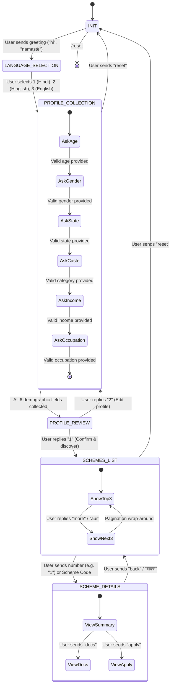

# YOJNA SETU V2 — CONVERSATION ENGINE SPECIFICATION
**Document:** `docs/v2/CONVERSATION_ENGINE.md`  
**Version:** 2.0.0  
**Pattern:** Finite State Machine (FSM) + Domain Orchestrator  
**Status:** APPROVED (PHASE 6 SPECIFICATION)  

---

## 1. Conversational Lifecycle & State Diagram

The conversation engine replaces the legacy 489-line God service (`ConversationService`) with an explicit, modular State Pattern.

---

## 2. Preventing the Profile Overwrite Corruption Bug

### 2.1 The Legacy Failure Mode
In legacy V1, any message from a returning user was sent to the Groq LLM. If the user asked `"Tell me about schemes for an 18 year old student"`, the legacy code blindly updated `profile.setAge(18)` and `profile.setOccupation("STUDENT")`, silently corrupting the citizen's profile.

### 2.2 The V2 Architectural Solution
1. **State Isolation:** Demographic updates are *only* executed when `session.currentState == PROFILE_COLLECTION`.
2. **Explicit User Review:** Once collected, the user reviews a summary in `PROFILE_REVIEW` and must explicitly confirm before `is_profile_complete = true` is set.
3. **Immutability in Browsing States:** While in `SCHEMES_LIST` or `SCHEME_DETAILS`, incoming messages are interpreted as navigation commands, scheme selectors, or document inquiries. Profile records remain untouched.

---

## 3. Persistent, Restart-Safe Session Storage

### 3.1 Elimination of In-Memory Maps
- The legacy `ConcurrentHashMap` instances (`shownCountMap`) are completely deleted.
- All session context is persisted in PostgreSQL table `yojna_setu.conversation_sessions`:
  - `current_state` (Enum)
  - `pagination_offset` (Integer offset, increments by 3)
  - `cached_eligible_schemes` (JSONB array of pre-matched Scheme UUIDs)
  - `last_interaction_at` (Timestamp)

### 3.2 Horizontal Scale-Out
Multiple Spring Boot pods behind an AWS ALB or Kubernetes ingress can process requests from the same user interchangeably. State is loaded and committed atomically within transactional database boundaries.
